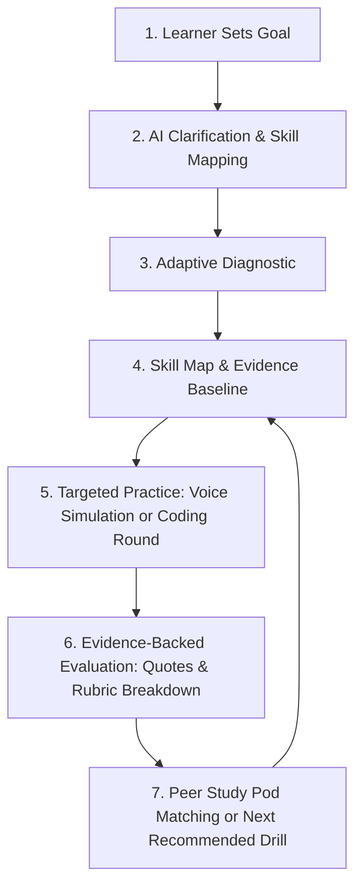

# LearnLoop — Evidence-Based Learning & Readiness Platform

> **Make career readiness visible through demonstrated ability—not just completed videos or quizzes.**

LearnLoop is a modern, full-stack, evidence-based learning and readiness platform built for students, career switchers, language learners, and bootcamps. It diagnoses relevant sub-skills, runs adaptive practice (including turn-by-turn conversational mock interviews with live speech-to-text and audio synthesis, as well as sandboxed coding rounds), evaluates answers against clear rubric criteria, and matches learners into complementary peer study pods.

---

## 1. Primary Product Loop



1. **Goal Setup**: Learner enters or chooses a learning goal (e.g., Campus Placement, System Design, Behavioral STAR, Sales Pitch, Language Fluency). The AI clarifies the goal and generates a 4-6 dimension skill taxonomy.
2. **Adaptive Diagnosis**: Scenario-based exercises adjust difficulty based on performance, evaluating true problem-solving and trade-off ability, distinguishing "unassessed" from "low skill".
3. **Practice Dashboard**: Displays the active goal, demonstrated readiness score (derived strictly from evidence citations, avoiding arbitrary "job-ready" claims), and next recommended action.
4. **Conversational Voice Simulation**: Spoken practice using browser Web Speech API for real-time speech-to-text, text editing fallback, server-side AI for natural follow-ups, and native SpeechSynthesis audio readout.
5. **Sandboxed Coding Round**: Problem statement, constraints, unit tests, code editor, and isolated test runner (with zero untrusted host execution).
6. **Peer Study Pods**: Transparent matching of 3-5 peers based on complementary strengths and gaps, structured group challenges, and peer-teaching roles with strict privacy boundaries (private practice transcripts are never leaked).

---

## 2. Core Architecture & Tech Stack

- **Web Client**: React 18, Vite, TypeScript, Lucide Icons, Canvas Confetti.
- **Styling**: Curated Vanilla CSS design system with sleek dark mode, glassmorphism, glowing accents (`#6366f1`, `#10b981`), micro-animations, and accessible focus outlines.
- **Backend & AI Gateway**: Node.js & Express server (`server/index.js` and `server/ai.js`) on port 3001. Kept strictly separate from the client bundle to ensure all secrets (`GROQ_API_KEY`, Supabase service role keys) never leak to the browser.
- **AI Inference**: Groq LLM API (`llama-3.3-70b-versatile`) with structured JSON schema output validation and deterministic high-fidelity domain fallbacks for offline development.
- **Persistence & Security**:
  - **Supabase Connected Mode**: Postgres database with 14 normalized tables, foreign keys, and Row-Level Security (RLS) policies.
  - **Seamless Local Persistence / Demo Mode**: Integrated localStorage engine enabling instant out-of-the-box exploration without external setup.
- **Speech Hardware**: Web Speech API (`SpeechRecognition` for audio input; `SpeechSynthesis` for spoken interviewer feedback), complete with error codes (`not-allowed`, `no-speech`, `network`, `audio-capture`).
- **Code Execution**: Safe isolated sandbox test runner for JavaScript/Python test evaluation with strict timeout and restricted system operations.

---

## 3. Database Schema & RLS

The database schema is located in `supabase/schema.sql` and includes:

1. `profiles`: Learner profiles with experience level tracking.
2. `learner_privacy_settings`: User controls for transcript retention, audio privacy, and pod progress sharing.
3. `skill_taxonomy`: Canonical skills, categories, and rubric criteria.
4. `goals`: User learning goals with target outcomes and deadlines.
5. `goal_skills`: Active skill maps with demonstrated scores, confidence ratings, and evidence counts.
6. `diagnostic_sessions`: Diagnostic session history and summary reports.
7. `diagnostic_items`: Individual diagnostic questions, responses, criteria, and evidence excerpts.
8. `practice_sessions`: Voice simulations and coding rounds.
9. `practice_turns`: Turn-by-turn dialogue history with timestamps.
10. `evaluations`: Evidence-backed rubric scores, excerpts, and rationale.
11. `coding_submissions`: Code submissions, test outputs, and complexity notes.
12. `study_pods`: Complementary study pods with matching rationales.
13. `study_pod_members`: Pod membership and complementary strength/gap matrices.
14. `pod_challenges`: Group challenges and peer-teaching deliverables.

All tables are secured with Row Level Security (RLS) ensuring learners can only access their private data, while pod members can access shared pod metadata without exposing private practice transcripts.

---

## 4. Local Setup Instructions

### Prerequisites
- Node.js (v18 or higher; tested on v24)
- npm (v9 or higher)

### Installation
```bash
# Clone and enter directory
cd d:/PERSONAL/LearnLoop

# Install dependencies
npm install
```

### Environment Configuration
Copy `.env.example` to `.env`:
```bash
cp .env.example .env
```

Configure your environment variables:
```ini
PORT=3001
GROQ_API_KEY=your_groq_api_key_here
GROQ_MODEL=llama-3.3-70b-versatile
VITE_SUPABASE_URL=https://your-project.supabase.co
VITE_SUPABASE_ANON_KEY=your_supabase_anon_key
```

> **Note**: LearnLoop runs seamlessly without any API keys configured! If keys are absent, the application automatically uses its high-fidelity deterministic evaluation engine and local persistence.

### Running the Application
```bash
# Run server and client concurrently
npm run dev

# Or run client and server independently:
npm run dev:server  # Starts backend server on http://localhost:3001
npm run dev:client  # Starts Vite frontend on http://localhost:5173
```

---

## 5. Verification & Testing

- **TypeScript Validation**: `npx tsc --noEmit` passes with 0 errors.
- **Production Build**: `npm run build` compiles clean bundles in under 5 seconds.
- **Backend Health Check**:
  ```bash
  curl http://localhost:3001/api/health
  ```
- **Code Runner Sandbox Verification**:
  ```bash
  curl -X POST http://localhost:3001/api/code/run \
    -H "Content-Type: application/json" \
    -d '{"code":"function solution(input){return input*2;}","language":"javascript","tests":[{"input":5,"expected":10}]}'
  ```

---

## 6. Security, Privacy & Reliability

- **No Secret Leaks**: API keys are isolated to the server (`server/ai.js`). No secrets are bundled in the Vite client.
- **Raw Audio Privacy**: Raw microphone audio is never uploaded or saved to remote disks; only recognized transcripts and rubric evaluations are retained according to learner privacy settings.
- **Untrusted Code Security**: Code submissions are executed inside an isolated sandbox with memory bounds and restricted system globals. Server process access is strictly blocked.
- **Graceful Fallbacks**: If Web Speech API is denied or unsupported, a live text fallback is provided with no disruption. If external AI or database providers are disconnected, LearnLoop provides clear UI notifications and operates reliably in local mode.
